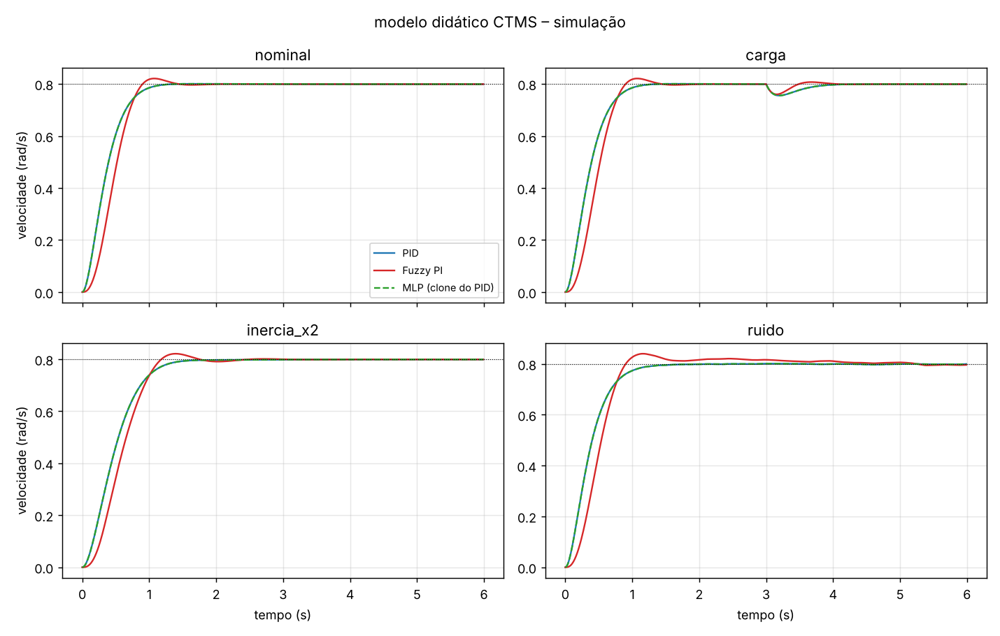

# Controle de Velocidade de Motor DC: PID, Fuzzy PI e Rede Neural

Comparação reprodutível de três controladores de velocidade para motor DC: simulação com
a mesma planta, o mesmo período de amostragem, a mesma saturação e o **mesmo critério de
sintonia** para todos, e firmware para Arduino Uno que executa **as mesmas leis de
controle**, verificadas amostra a amostra contra a simulação.

> **Escopo dos números abaixo:** são de **simulação**, sobre o modelo didático de motor
> DC dos *Control Tutorials for MATLAB & Simulink* (University of Michigan). Não são
> medições de bancada. O fluxo para obter os números do motor físico está em
> [Da simulação para a bancada](#da-simulação-para-a-bancada).

## Resultados (simulação, modelo CTMS)

Ts = 10 ms · saturação ±12 V · referência 0,799 rad/s · gerados por `python run_all.py`
(tabela completa em [`results/ctms/metricas.md`](results/ctms/metricas.md)).

| Cenário | Métrica | PID | Fuzzy PI | MLP (clone do PID) |
|---|---|---|---|---|
| Nominal | overshoot | 0,12 % | 2,71 % | 0,12 % |
| | acomodação (±2 %) | 0,98 s | 1,21 s | 0,98 s |
| | IAE | 0,293 | 0,377 | 0,293 |
| | variação total de u | 5,1 V | 16,3 V | 5,1 V |
| Degrau de carga (5 % do torque de partida) | queda máxima | 5,49 % | 4,91 % | 5,49 % |
| | recuperação (±2 %) | 0,60 s | 0,36 s | 0,60 s |
| Planta alterada (J ×2, b +20 %) | overshoot | 0,00 % | 2,77 % | 0,00 % |
| | acomodação | 1,30 s | 1,55 s | 1,30 s |
| Ruído de medição (σ = 1,25 %) | overshoot | 0,25 % | 5,13 % | 0,25 % |
| | acomodação | 1,11 s | 3,11 s | 1,11 s |
| | variação total de u | 93 V | 142 V | 93 V |



**Leitura honesta:**

- Com sintonia equivalente, o **PID** (na prática um PI: o Kd ótimo deu ≈ 0) vence no
  rastreamento, na variação de planta e sob ruído. O **Fuzzy PI** rejeita melhor o degrau
  de carga (recupera 40 % mais rápido), mas com mais overshoot e mais atividade de
  controle, e degrada mais com ruído. Nenhum dos dois é "mais robusto" em geral: depende
  do cenário.
- A **MLP** reproduz o PID e não o supera, por construção. Uma regressão linear acerta o
  mesmo alvo com erro de 10⁻¹⁴ V. Detalhes e limitações em [`docs/ml_theory.md`](docs/ml_theory.md).
- **Cálculo à mão × otimização:** o método IMC/lambda, feito à mão, fica a 9 % do custo
  ótimo, e o otimizador reencontrou a mesma estrutura (cancelar o polo lento, Kd ≈ 0).
  Ziegler-Nichols satura e amplifica ruído 21 vezes. Os cálculos passo a passo estão em
  [`docs/comparacao_sintonia.md`](docs/comparacao_sintonia.md).
- Os ganhos dependem dos pesos da função custo ([`docs/theory.md`](docs/theory.md), §5).
  Overshoot perto de 5 % reflete a restrição imposta, não uma propriedade do controlador.

**Custo computacional no ATmega328P a 16 MHz** (ciclos medidos no simulador simavr, só
a lei de controle): PID 0,24 ms · Fuzzy 0,37 ms · MLP 1,1 ms em média (1,5 ms no pior
caso). A MLP não cabe numa malha de 1 kHz no Uno; a 100 Hz, todas cabem.

## Estrutura

```
motorlib/                   núcleo: planta, controladores, fuzzy, sintonia, ML, métricas, identificação
run_all.py                  pipeline completo -> results/<nome>/ (+ firmware com --arduino)
analisar_ensaio.py          métricas de um log de bancada, lado a lado com a simulação
simulations/
  pid/motor_pid_simulation.py     PID original x sintonizado
  auto_tuning/auto_tune_pid.py    sintonia por evolução diferencial
  auto_tuning/comparar_metodos.py Ziegler-Nichols e IMC à mão x otimização
  fuzzy/fuzzy_controller.py       base de regras, superfície, malha fechada
  identificacao/identify_motor.py identificação de J e b a partir do ensaio
ml_control/                 coleta -> treino -> avaliação da MLP
arduino/
  motor_control/            sketch único (ensaio, PID, Fuzzy, MLP) + leis de controle em C
  benchmark/                medição de ciclos de CPU de cada controlador
dashboard/realtime_plot.py  gráfico em tempo real e gravação do log em CSV
results/ctms/               resultados publicados (métricas, ganhos, pesos, figuras)
tests/                      testes automatizados, inclusive paridade C x Python
docs/                       teoria, hardware, ML
auditoria/                  auditoria da versão anterior e script que a reproduz
```

## Reproduzir

```bash
pip install -r requirements.txt
```

```bash
python -m pytest
```

```bash
python run_all.py
```

O pipeline leva cerca de 30 s e é determinístico (sementes fixas). O firmware compila na IDE
Arduino abrindo `arduino/motor_control/motor_control.ino` (placa: Arduino Uno). Não
precisa de bibliotecas externas.

## Da simulação para a bancada

Os ganhos em `arduino/motor_control/parametros_gerados.h` vêm do **modelo didático e não
servem para um motor real**. O passo a passo detalhado, com medições, segurança e checklist
de publicação, está em [`docs/roteiro_bancada.md`](docs/roteiro_bancada.md). Em resumo:

1. Monte o hardware conforme [`docs/hardware.md`](docs/hardware.md). O encoder é obrigatório. Meça R, K, v_max e o número de contagens por volta.
2. Grave o sketch com `MODO_CONTROLE 0` e registre o ensaio em malha aberta:
   `python dashboard/realtime_plot.py --porta COM3 --csv ensaio.csv`
3. Identifique o motor:
   `python simulations/identificacao/identify_motor.py ensaio.csv --R ... --K ... --v_max ...`
   Se o R² ficar abaixo de 0,98, investigue antes de seguir.
4. Sintonize e gere o firmware:
   `python run_all.py --params results/motor_identificado.json --arduino`
5. Para cada `MODO_CONTROLE` (1, 2, 3), grave o sketch e registre um CSV.
6. Compare com a simulação:
   `python analisar_ensaio.py ensaio_pid.csv --params results/motor_identificado.json --controlador pid`

Antes de citar qualquer número de bancada, confira duas coisas: se a coluna `estouros` do
log terminou em 0 e se a resolução do encoder é fina o bastante para a tolerância usada
([`docs/hardware.md`](docs/hardware.md)).

## Histórico

A versão anterior deste repositório tinha simulações que não executavam e firmware que
não compilava. A tabela comparativa não podia ser reproduzida: os ganhos publicados
levavam a 82 s de acomodação, e não aos 2 s declarados. Também não havia medição de
velocidade no hardware, e o pipeline de ML treinava sobre ruído aleatório. O diagnóstico
completo, com o script que o reproduz, está em [`auditoria/AUDITORIA.md`](auditoria/AUDITORIA.md).

## Créditos

Desenvolvido por Amanda Freire. Projeto educacional de automação e controle.
Modelo do motor: Control Tutorials for MATLAB & Simulink, University of Michigan.
