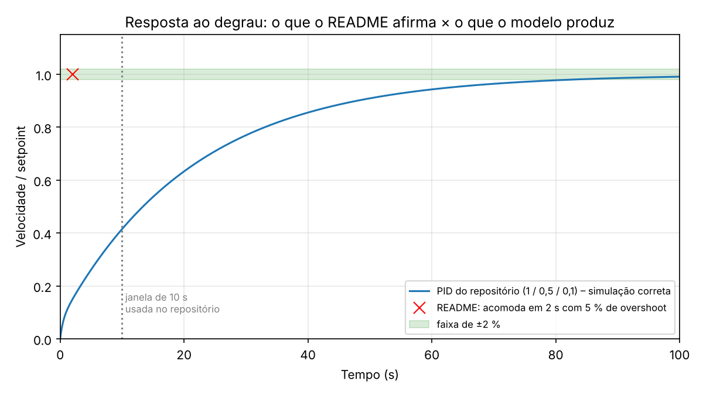

# Auditoria técnica – motorcontrolproject

Data: 2026-11-18 · Escopo: todos os 16 arquivos versionados (commit `e69d29a`).
Reprodução: `pip install -r auditoria/requirements.txt && python auditoria/reproduzir_auditoria.py`

## Grau de confiança de cada achado

| Marca | Significado |
|---|---|
| **[EXEC]** | Verificado executando código (Python 3.13, SciPy 1.18.1, scikit-fuzzy 0.5.0, python-control 0.10.2) |
| **[COMP]** | Verificado com compilador `g++ -fsyntax-only` + stubs da API Arduino (não é o toolchain AVR oficial) |
| **[DED]** | Dedução por leitura de código, datasheet ou semântica de biblioteca – não executado em hardware |

Nenhum teste foi feito em hardware físico. Nenhum achado abaixo depende de hardware para ser válido.

---

## Resumo executivo

Nenhum dos três controladores (PID, Fuzzy, ML) funciona como entregue, e **os números da tabela
comparativa do README não podem ser produzidos por nenhum código do repositório**. Quando a
simulação do PID é corrigida apenas na API (mesma planta, mesmos ganhos), o resultado real é
**0 % de overshoot e 82 s de acomodação**, contra os **5 % e 2 s** declarados.

---

## 1. Críticos – o artefato não executa ou o resultado declarado é falso

### C1. Simulação do PID não executa **[EXEC]**
`simulations/pid/pid:17` e `simulations/auto_tuning/auto_tune_pid.py:21`
- `scipy.signal.feedback` não existe no SciPy → `AttributeError`.
- Mesmo removendo essa linha, `pid * system` falha: `TransferFunction` do SciPy não implementa
  `*` → `TypeError`. As funções corretas são `control.feedback` / `control.tf` (pacote `python-control`).
- O arquivo não tem extensão `.py`; o README o chama de `motor_pid_simulation.py`, que não existe.

### C2. A tabela comparativa do README é irreprodutível e contradita pela simulação **[EXEC]**
`README.md` – "PID: overshoot 5 %, estabilização 2 s".

Com a planta e os ganhos do próprio repositório (Kp=1, Ki=0,5, Kd=0,1), simulação correta:

| Métrica | README | Simulação |
|---|---|---|
| Overshoot | 5 % | **0,00 %** |
| Acomodação (±2 %) | 2 s | **82,4 s** |
| Subida (10–90 %) | – | 46,9 s |
| y(2 s) | ~1,0 | **0,150** |
| y(10 s) (janela do script) | – | **0,415** |

Causa: polo de malha fechada dominante em **s = −0,0466** (τ ≈ 21 s), criado por ganhos
~100× menores que o necessário para uma planta com ganho DC de 0,0999 (rad/s)/V.
Para referência, os ganhos 100/200/10 do tutorial de onde a planta vem dão 1,03 % e 0,26 s.

- O gráfico gerado pelo script (janela de 10 s) mostraria a velocidade em **41 %** do setpoint –
  o próprio artefato contradiria a tabela, se executasse.
- Os números do Fuzzy (15 %, 4 s) **não têm origem possível**: não há simulação em malha fechada
  do fuzzy (o script avalia o controlador em um único ponto e não há modelo da planta acoplado).
- "Robustez: Boa / Muito Boa" não tem métrica definida nem teste (variação paramétrica, perturbação de carga, margens).
- "Controladores comparados em ambiente simulado e físico" – não há dados, logs ou gráficos de ensaio físico.

### C3. Autotuning seleciona o pior controlador da grade **[EXEC]**
`auto_tune_pid.py` (corrigida só a API, mesma grade e critério):
- Critério único = minimizar overshoot medido como `(max(y) − y[-1]) / y[-1]` em 10 s.
- Como nenhuma resposta acomoda em 10 s, **74 de 75 candidatos empatam em 0 %**; vence o primeiro
  da grade: **Kp=0,1, Ki=0,01, Kd=0**, que chega a **1,9 %** do setpoint em 10 s.
- O melhor candidato da grade chega a 44,6 % em 10 s – a grade inteira está fora da região útil.
- Falta critério de desempenho (IAE/ITAE/ISE, tempo de acomodação) e restrição de esforço de controle.

### C4. Sketch PID não compila **[COMP]**
`arduino/pid/motor_pid.ino:25,27` – `Serial.print(\"Setpoint: \");`
→ `error: stray '\' in program` / `missing terminating " character`. Aspas escapadas fora de string literal.

### C5. Motor nunca gira no sketch PID (mesmo após corrigir C4) **[DED]**
`IN1` (7) e `IN2` (8) são configurados como `OUTPUT` e **nunca escritos** → permanecem `LOW`.
No L298 (datasheet ST), `EN=H` com `C=D` é "fast motor stop". O PWM em `ENA` não produz torque.

### C6. Fuzzy no Arduino: controle invertido e motor nunca parte **[DED + EXEC p/ centróide]**
`arduino/fuzzy/fuzzy_motor.ino`
- 1 conjunto de entrada (`negativo`, erro ∈ [−10, 0]), 1 conjunto de saída, **1 regra**.
- `erro = 100 − analogRead(A0)/10` ∈ [−2,3; 100]. A regra só dispara com rpm ≥ 100.
- Com rpm < 100 (inclusive na partida, rpm = 0) nenhuma regra dispara → saída 0 → PWM 0 → **motor parado indefinidamente**.
- Quando dispara (rpm acima do setpoint), a saída é o centróide do trapézio "reduzir" ≈ **63 PWM**:
  o controlador **aumenta** a tensão quando deveria reduzir (o nome do conjunto contradiz o efeito).
- Também não aciona `IN1/IN2` (mesmo problema de C5).
- Não tem relação com o fuzzy da simulação Python (2 entradas, 3 conjuntos cada, 3 regras).

### C7. Pipeline de ML não treina um controlador e o modelo publicado é vazio **[EXEC]**
- `trained_model.h5` tem **1 byte** (`\n`) → `load_model` falha (`file signature not found`).
- `ml_control/requirements.txt` tem 1 byte (vazio) – TensorFlow nem é declarado.
- `data_collection.py`: a "velocidade" é ruído i.i.d. N(95, 5), sem dinâmica e sem relação com o
  sinal de controle (autocorrelação lag-1 ≈ 0). Não é coleta de dados – é amostragem aleatória.
- `model_training.py`: **alvo = erro**, não controle. E o alvo é função exata das entradas
  (`erro = setpoint − velocidade = 10 × control_signal`, |resíduo| = 1,8·10⁻¹⁵): **vazamento de rótulo**.
- Setpoint constante (desvio-padrão 0) → feature inútil; o modelo não generaliza para outro setpoint.
- Sem normalização e sem conjunto de validação – exatamente as etapas que `docs/ml_theory.md` prescreve.
- `ml_controller.py` passa `control_signal = 0` na 3ª entrada (fora da distribuição de treino:
  para speed=90 o valor visto no treino seria 1,0) e interpreta a saída (um erro) como sinal de controle.
- Melhor caso teórico: a rede reproduziria um controlador P com Kp = 0,1 – com escala trocada por 10×.

---

## 2. Graves – erro de engenharia que invalida o resultado mesmo após correções simples

### G1. Fuzzy Python: base de regras incompleta e sinal inconsistente **[EXEC]**
`simulations/fuzzy/fuzzy_controller.py`
- 3 regras para um espaço 3×3 (9 combinações). **25 % da grade de entradas não produz saída**
  (skfuzzy lança `KeyError: 'saida'`), ex.: (e=+8, Δe=−3) e (e=−8, Δe=+3) – estados normais de um transitório.
- Para (e ≥ 5, Δe = 0) a saída −0,5 é **artefato numérico**: `np.arange(-5,5,0.1)` não contém o 0
  exato, e a pertinência de `Δe['pos']` em 0 vale 3,6·10⁻¹⁵ ≠ 0. A regra dispara por resíduo de ponto flutuante.
- Sinal: com a convenção e = r − y (usada no Arduino), "erro negativo → aumentar" e
  "erro positivo → diminuir" estão **invertidas**. O arquivo não define a convenção; no mínimo é inconsistente com o restante do projeto.
- Universos com `np.arange` excluem o extremo (+10 / +5 / +1): os picos de `pos`/`aumentar` ficam fora do universo.
- Saída em [−1, 1] sem escala/integração para tensão ou PWM; não há malha fechada.

### G2. Não existe medição de velocidade **[DED]**
`lerRPM()` = `analogRead(A0)/10` → valor 0–102,3 rotulado "RPM". Nenhum sensor em A0 é listado
em `docs/hardware.md`; o encoder é "opcional" e nunca é lido no código. Sem encoder/tacogerador,
não há realimentação de velocidade – logo não há controle em malha fechada no hardware.

### G3. Ganhos da simulação transplantados para o Arduino sem mudança de unidade **[DED]**
Na simulação: entrada em V, saída em rad/s, degrau unitário. No Arduino: entrada em contagens ADC/10,
saída em PWM 0–255, setpoint 100. Os ganhos 1/0,5/0,1 não têm significado transferível.
Além disso, a planta é a do tutorial CTMS (U. Michigan, "DC Motor Speed: System Modeling",
J=0,01 b=0,1 K=0,01 R=1 L=0,5), **não identificada para o motor físico e sem citação da fonte**.

### G4. Dashboard não funciona com nenhum dos sketches **[EXEC + DED]**
`dashboard/realtime_plot.py`
- Sketch PID envia `"Setpoint: 100.00 | RPM: x"` → `float()` lança `ValueError` na 1ª linha.
- Sketch Fuzzy envia o PWM, não o RPM – o gráfico seria rotulado errado.
- Vazão a 9600 baud: ~31 linhas/s (PID) e ~137 linhas/s (Fuzzy) contra 10 linhas/s lidas
  (1 `readline` por tick de 100 ms) → **o atraso cresce sem limite**; não é "tempo real".
- `readline()` bloqueante dentro do timer da GUI congela a interface; replot de todo o histórico a cada tick é O(n).
- Porta `COM3` fixa (só Windows); abrir a serial reinicia o Uno e a 1ª linha pode chegar truncada.

---

## 3. Documentação e reprodutibilidade

| # | Problema | Evidência |
|---|---|---|
| D1 | `docs/theory.md` é cópia de `docs/ml_theory.md` (só ML). **Não há teoria de PID nem de Fuzzy** em lugar algum, embora o README remeta a ela | `diff` difere só em formatação Markdown |
| D2 | Árvore do README lista `motor_pid_simulation.py` (inexistente) e omite `ml_control/`, `theory.md`, `hardware.md` | `git ls-files` |
| D3 | README cita "Python ou MATLAB" – não há arquivo MATLAB | `git ls-files` |
| D4 | Dependências: não há requirements para PID/autotune (scipy), dashboard (pyserial, pyqtgraph, PyQt5) nem ML (tensorflow). Nenhuma versão fixada | arquivos `requirements.txt` |
| D5 | `hardware.md` não menciona **GND comum** Arduino–L298N nem remoção do jumper de ENA | leitura |
| D6 | L298N (bipolar) tem queda típica de ~2 V+ – o motor não recebe 12 V; relevante para qualquer identificação de planta | datasheet ST L298 **[DED]** |
| D7 | "Código modular e comentado" – praticamente não há comentários; não há testes | leitura |
| D8 | "TensorFlow Lite para substituir PID": o Uno (ATmega328P, 2 KB SRAM, 8 bits) não é alvo do TFLite Micro, que mira MCUs de 32 bits **[DED – confirmar na doc oficial antes de publicar]** | – |
| D9 | Histórico: 33 commits no mesmo dia, todos "Create/Update X" via interface web; nenhum dado experimental versionado | `git log` |

---

## 4. O que é seguro (e o que não é) afirmar publicamente

**Pode afirmar, com dados reproduzíveis:**
- Simulação corrigida do PID: 0 % de overshoot, 82,4 s de acomodação, vs. 5 %/2 s declarados.
- Autotuning por overshoot puro seleciona o controlador mais lento (74/75 empatados em 0 %).
- 25 % do espaço de entradas do fuzzy Python não tem regra; um ponto "funciona" por resíduo de 3,6·10⁻¹⁵.
- Dataset de ML com vazamento de rótulo exato e modelo publicado com 1 byte.
- Sketch PID não compila (aspas escapadas).

**Afirme com ressalva ("pela leitura do código e do datasheet"):**
- Motor não gira por IN1/IN2 em LOW; fuzzy do Arduino nunca dá partida; ausência de sensor de velocidade.

**Não afirme:**
- Qualquer número de desempenho do Fuzzy ou do hardware físico (não há dado nenhum).
- Que fuzzy é "mais robusto" que PID (não testado aqui nem lá).
- Que a planta representa o motor real (é o modelo didático da U. Michigan).
- Que os ganhos 100/200/10 são "os corretos" para o seu motor – são do modelo didático.

---

## 5. Status das correções (versão atual do repositório)

| Achado | Correção | Verificação |
|---|---|---|
| C1 simulação não executa | `python-control` + simulação discreta em `motorlib/` | todos os scripts executam; `pytest` |
| C2 tabela irreprodutível | tabela gerada por `run_all.py` a partir de `results/ctms/metricas.json`; rotulada como simulação do modelo CTMS | `results/ctms/` |
| C3 autotuning degenerado | evolução diferencial com ITAE + restrição de overshoot + penalidade de ruído; mesmo critério para PID e Fuzzy | 3 sementes → mesmos ganhos (4 alg. sig.) |
| C4 sketch não compila | sketch único `arduino/motor_control/` | compilado com avr-gcc 7.3 + ArduinoCore-avr para ATmega328P, 4 modos, `-Wall -Wextra` sem avisos |
| C5 IN1/IN2 nunca escritos | `aplicarTensao()` define o sentido a cada amostra | leitura de código |
| C6 fuzzy Arduino invertido | Arduino usa a mesma superfície 5×5 da simulação (tabela na flash) | `tests/test_paridade_c.py` (C x Python) |
| C7 ML sem sentido | clonagem do PID com estados corretos, validação por episódio, regressão linear como linha de base, todas as sementes reportadas | `docs/ml_theory.md`, testes |
| G1 fuzzy incompleto | base 5×5 completa, `linspace`, convenção e = r − y | testes de completude, sinal e antissimetria |
| G2 sem sensor de velocidade | encoder em quadratura ×4 por interrupção | tabela de transições verificada nos dois sentidos |
| G3 ganhos sem unidade | firmware trabalha em V e rad/s; ganhos gerados do modelo identificado | `identify_motor.py` + `run_all.py --params` |
| G4 dashboard | leitura CSV não bloqueante, esvazia o buffer, grava log, alerta de estouro | testado com porta serial simulada (`loop://`) |
| D1–D7 documentação | `docs/theory.md`, `docs/hardware.md`, `docs/ml_theory.md` e README reescritos; dependências fixadas | – |

**Ainda NÃO verificado:** nenhum ensaio em hardware físico foi feito. O fluxo de bancada
(ensaio → identificação → sintonia → análise) foi exercitado de ponta a ponta apenas com
um motor **sintético** emulado, com quantização de encoder e ruído.
