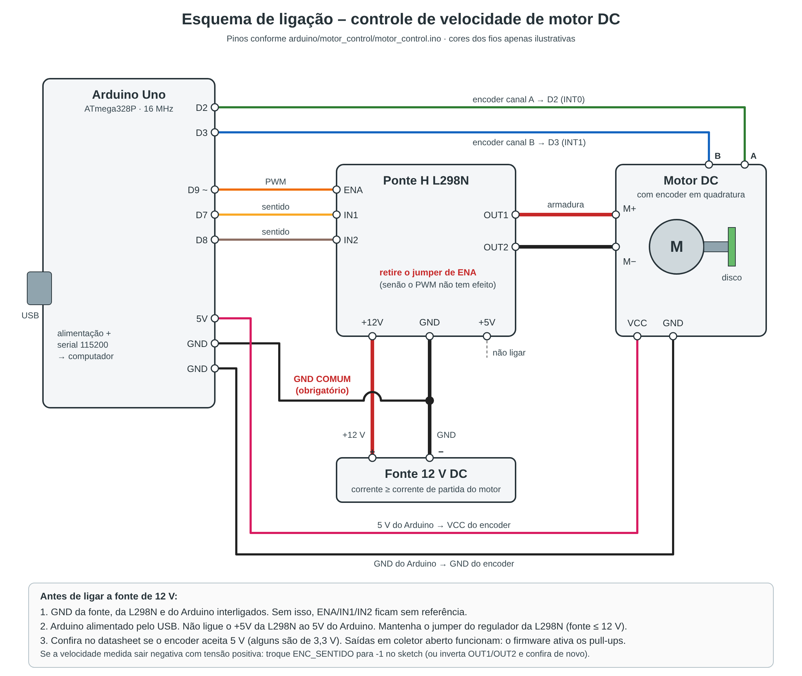

# Roteiro de bancada

Do motor na mesa até os números publicáveis. Faça na ordem: cada etapa usa o resultado da
anterior. Tempo estimado: 2 a 3 horas na primeira vez.

> **Segurança:** os ganhos que vêm no repositório são do modelo didático e **não servem
> para o seu motor**. Até a etapa 5, use **apenas o `MODO_CONTROLE 0`**, que é em malha
> aberta (tensões fixas, sem realimentação). Fixe o motor na mesa: o degrau de 90 % da
> tensão dá um tranco. Mantenha a mão longe do eixo e tenha como desligar a fonte de 12 V.

## 0. Material e software

- Arduino Uno, L298N, motor DC **com encoder em quadratura**, fonte de 12 V, multímetro e jumpers.
- No computador: IDE Arduino e Python 3.10 ou mais recente.
  ```
  pip install -r requirements.txt
  pip install -r requirements-dashboard.txt    (só se quiser o gráfico ao vivo)
  ```
- Anote o modelo do motor e do encoder: você vai precisar do datasheet.

## 1. Montagem

Siga o esquema abaixo e a tabela de [`hardware.md`](hardware.md).


 Três pontos causam a maioria das falhas:

1. **Jumper de ENA retirado.** ENA vai no pino D9.
2. **GND da L298N ligado ao GND do Arduino.**
3. **Encoder A em D2 e B em D3**, ambos pinos de interrupção.

## 2. Medições antes de ligar o controle

Anote tudo numa planilha, com data. Esses números entram no artigo.

| Grandeza | Como medir | Exemplo |
|---|---|---|
| **R** (resistência) | Motor desligado da L298N. Multímetro em Ω nos dois fios do motor. Gire o eixo um pouco e meça de novo, umas 5 vezes; use a média. | 4,1 Ω |
| **CPR** (contagens por volta) | Do datasheet: 4 × PPR do encoder × redução. Ex.: encoder de 11 PPR, redução de 1:34 → 4 × 11 × 34 = 1496. A etapa 3 confere esse valor. | 1496 |
| **v_max** (tensão real) | Etapa 4: multímetro em V DC nos fios do motor, durante o patamar de 90 %; divida por 0,9. | 10,2 V |
| **K** (constante de FCEM) | Etapa 4: durante o mesmo patamar, meça a corrente I (multímetro em série, escala de A) e anote a velocidade ω do log. K = (V − R·I) / ω. | 0,29 V·s/rad |

A unidade de K é V·s/rad, com ω em **rad/s**, que é a unidade do log. Para converter rpm
em rad/s, multiplique por 0,1047.

## 3. Conferir o encoder (5 minutos)

1. Abra `arduino/motor_control/motor_control.ino` na IDE. No topo, ajuste:
   ```cpp
   #define MODO_CONTROLE 0
   #define ENC_CPR 1496.0f      // o seu valor
   ```
2. **Com a fonte de 12 V desligada**, grave o sketch no Uno.
3. Abra o Monitor Serial a 115200 baud e gire o eixo de saída **uma volta** à mão, devagar.
   A soma da coluna `w_rad_s` × 0,01 deve dar cerca de 6,28 (2π). Se der um múltiplo
   disso, corrija o `ENC_CPR`. O modo 0 envia dados só por cerca de 8 s (depois aparece
   `# fim do ensaio`); aperte o botão RESET do Uno para recomeçar. Para facilitar a soma,
   copie a saída para uma planilha.
4. Se a velocidade sair negativa girando no sentido "para frente", troque `ENC_SENTIDO` para -1.
5. **Feche o Monitor Serial** antes da próxima etapa. Duas janelas não podem usar a mesma porta.

## 4. Ensaio em malha aberta (identificação)

1. Ligue a fonte de 12 V.
2. Grave o ensaio. A porta é `COM3`, `COM4`... no Windows (veja na IDE em Ferramentas > Porta)
   e `/dev/ttyACM0` no Linux:
   ```
   python dashboard/realtime_plot.py --porta COM3 --csv ensaio_malha_aberta.csv
   ```
   Abrir a porta reinicia o Arduino, e o ensaio começa sozinho:

   | Etapa | Duração | Tensão |
   |---|---|---|
   | parado | 0,2 s | 0 |
   | degrau | 2 s | 50 % |
   | degrau | 2 s | 90 % |
   | degrau | 2 s | 30 % |
   | parado | 2 s | 0 |

   Aparece `# fim do ensaio` depois de cerca de 8 s. Feche a janela.
3. **Durante o patamar de 90 %**, meça a tensão e a corrente do motor (etapa 2). Se
   precisar de mais tempo, aumente a duração do degrau em `ENSAIO_MS` no sketch.
4. Repita o ensaio **3 vezes**, salvando `ensaio_1.csv`, `ensaio_2.csv` e `ensaio_3.csv`.
   Isso permite reportar a variação entre ensaios, e não um número isolado.

## 5. Identificar o motor

```
python simulations/identificacao/identify_motor.py ensaio_1.csv --R 4.1 --K 0.29 --v_max 10.2
```

- Confira o **R²** impresso e o gráfico: a curva do modelo deve passar sobre os pontos.
  - **R² ≥ 0,98:** siga em frente.
  - **R² < 0,98:** não siga. Causas comuns: zona morta da L298N (o motor não sai do lugar
    a 30 %), folga da redução, ruído no encoder, ou a fonte caindo no degrau.
- Rode também com `ensaio_2.csv` e `ensaio_3.csv`. J e b devem variar poucos por cento
  entre eles. Use o JSON do ensaio 1, ou edite o arquivo com a média.

## 6. Sintonizar e gerar o firmware do SEU motor

```
python run_all.py --params results/motor_identificado.json --arduino
```

Isso cria `results/identificado/`, com a tabela de simulação **do seu motor**, e reescreve
`arduino/motor_control/parametros_gerados.h` com os ganhos, a tensão máxima e a referência
corretos. Abra `results/identificado/metricas.md` e anote as previsões.

## 7. Ensaios em malha fechada

Para cada controlador: mude `#define MODO_CONTROLE` para 1 (PID), 2 (Fuzzy) ou 3 (MLP),
grave o sketch e rode:

```
python dashboard/realtime_plot.py --porta COM3 --csv pid_1.csv
```

O motor fica parado por 0,5 s e depois recebe o degrau de referência. Espere cerca de 10 s
e feche. Faça **3 repetições de cada controlador**: são 9 arquivos.

**Teste de carga (opcional, mas é o que diferencia os controladores):** com o motor em
regime, aplique uma carga repetível. Pode ser um peso preso por um fio enrolado no eixo,
ou um freio de fricção com uma pinça. Meça a queda de velocidade e o tempo de recuperação
no log. A carga precisa ser **a mesma** nos três controladores.

## 8. Analisar

```
python analisar_ensaio.py pid_1.csv --params results/motor_identificado.json --controlador pid
```

O script mostra **bancada × simulação** lado a lado, mais o tempo de execução real do
laço. Repita para cada arquivo (`--controlador fuzzy` / `mlp`).

## Antes de publicar qualquer número

- [ ] `estouros_total` = 0 em todos os logs. Se não for, o período de amostragem não foi de 10 ms.
- [ ] Resolução do encoder = 2π / (CPR × 0,01) bem menor que 2 % da referência. Se não
      for, a "acomodação em 2 %" não pode ser medida.
- [ ] 3 repetições por controlador; reporte média e faixa (mínimo–máximo).
- [ ] Mesma referência e mesma carga para os três controladores.
- [ ] R² da identificação anotado.
- [ ] Discrepâncias entre bancada e simulação **explicadas ou declaradas**. Elas são o
      conteúdo mais interessante do artigo.
- [ ] Logs CSV, `motor_identificado.json` e `results/identificado/` commitados no
      repositório, para quem quiser conferir.
